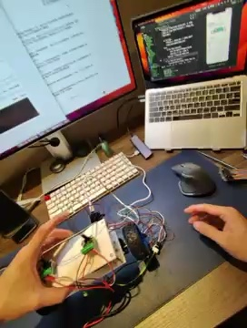

# GyroMan · 两轮平衡车

小车向前倾时，车轮需要向前追上重心。GyroMan 用 MPU6050 观察车身倾角，同时用轮轴上的霍尔编码器测量速度，让 ESP32 同时处理「站稳」和「别越跑越快」两个问题。

[实机视频 1 · 1 分 07 秒](media/1.mp4) · [实机视频 2 · 19 秒](media/2.mp4) · [车体照片](media/1.png)

## 控制过程

| 环节 | 输入 | 输出与节拍 |
| --- | --- | --- |
| 速度外环 PI | 霍尔编码器反馈、目标速度 | 每 20 ms 更新目标倾角偏移 |
| 姿态内环 PD | 目标角度、融合倾角与陀螺仪角速度 | 每 3 ms 更新电机 PWM |
| 电机输出 | 左右轮指令与方向配置 | ESP32 驱动 DRV8871，超出保护条件时切断输出 |

## 固件入口

- [主控制循环](firmware/gyroman_cascade_pid/gyroman_cascade_pid.ino)包含双环控制、速度积分、左右轮补偿和倾倒保护。
- [硬件映射](firmware/gyroman_cascade_pid/hardware_config.h)定义 I²C、电机和编码器引脚，以及每轮等效脉冲数。
- [姿态估计](firmware/gyroman_cascade_pid/kalman_1d.h)融合加速度计与陀螺仪读数。

使用 Arduino IDE 和支持 `ledcAttach` 的 ESP32 Arduino 3.x 开发包打开同名 .ino 工程。代码中的增益、极性和限幅配合演示样车调定。移植前先架空车轮确认左右轮正转方向、编码器符号和车体倾角符号。
